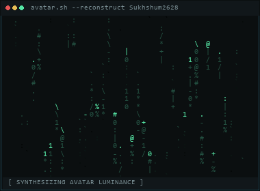

<div align="center">

# Sukhshum Vaishnavi

**Software Engineer**  
Distributed Systems • Multiplayer Networking • Backend Engineering • AI Platforms

<br/>

<a href="https://github.com/Sukhshum2628"></a>

<br/>

[](https://github.com/Sukhshum2628?tab=repositories)
[](https://www.linkedin.com/in/sukhshum-vaishnavi/)
[](https://sukhshum-portfolio.vercel.app/)
[](mailto:sukhsham2628@gmail.com)

<br/>

`[ STATUS: HOST AUTHORITY ACTIVE // DEVELOPING DISTRIBUTED SYSTEMS & STALKER-MP ]`

</div>

---

## $ neofetch --brief

```bash
sukhshum@workstation
--------------------
ROLE        : Software Engineer
SPECIALTIES : Distributed Systems, Multiplayer Networking, AI & ML, Systems Engineering
STACK_CORE  : C++17 / Python / TypeScript / Node.js / Docker
PRINCIPLES  : Host Authority • Deterministic Simulation • Preserve Before Replace
STATUS      : Developing STALKER-MP & exploring distributed architectures
```

---

## 🎮 Flagship: STALKER-MP

### [STALKER-MP // Persistent Multiplayer ALife Framework](https://github.com/Sukhshum2628/STALKER-MP)

> A modular, host-authoritative multiplayer framework layered on top of the X-Ray Monolith engine (S.T.A.L.K.E.R. Anomaly) that introduces a shared, persistent Zone without forking or rewriting the upstream engine.

```
[ Clients ] ──(Requests Only)──► [ Host-Authoritative Zone Engine ]
                                  ├── World & EntityRegistry (Deterministic)
                                  ├── A-Life Online/Offline Bubbles
                                  └── Snapshot & UDP Platform Transport
```

- **Host Authority:** Clients issue requests only; the host drives all world state, player lifecycle, and A-Life simulation transitions.
- **Deterministic Pipeline:** Strict per-frame execution ordering (`World` → `EntityRegistry` → `Lifecycle` → `Bubble` → `Snapshot` → `Networking`).
- **Engine ABI Boundaries:** Strict isolation with zero exceptions/RTTI across engine units (`EngineAdapters.cpp`) and OS sockets (`PlatformSockets.cpp`).

`Tech: C++17 • Visual Studio 2022 • GCC • GoogleTest • UDP • X-Ray Monolith`

---

## 💼 Featured Engineering Projects

### 📝 [Flask Blog — AI-Assisted Publishing & Hybrid-Search RAG Platform](https://github.com/Sukhshum2628/Flask-Blog-Website)

> A production-hardened Flask publishing platform with a retrieval-augmented LLM assistant, evaluated end-to-end with an empirical RAGAS harness rather than shipped on assumption.

- **Hybrid Retrieval Architecture:** Dense semantic search (NVIDIA NIM embeddings) fused with sparse BM25 lexical indexing via Reciprocal Rank Fusion, closing the vocabulary-mismatch gap that pure embedding search misses on exact names, numbers, and technical terms.
- **Empirical RAG Evaluation:** Built a RAGAS-based evaluation harness from scratch — synthetic + manually curated adversarial question sets (negative controls, multi-post synthesis, exact-entity lookups) generated directly from the live corpus, with held-out splits to guard against prompt overfitting.
- **Root-Caused Multiple Production-Grade Bugs via Evaluation:** Diagnosed and fixed a silent LLM reasoning-token exhaustion bug that was causing the generation client to fall back to an ungrounded prompt on 90%+ of calls, and a RAGAS judge-timeout issue that was silently dropping evaluation samples — both found by refusing to trust aggregate metrics without sample-size and paired-comparison scrutiny.
- **Security Hardening:** Resolved production/test database cross-contamination with enforced test-database isolation, hardened session, CSRF, and password-reset flows, and reconciled a full security branch into `main` via reviewed PR with a 115-test regression suite.
- **Operational Hygiene:** Production-safe, read-only-credentialed data export pipeline for evaluation dataset construction; repository cleanup removing 21 stale files while preserving all security and evaluation tooling.

`Tech: Python 3.12 • Flask • MongoDB Atlas • NVIDIA NIM (Llama 3 / Nemotron) • BM25 (rank_bm25) • RAGAS • Gunicorn • Render`

### 🏗️ [ConstructIQ — AI Construction Intelligence](https://github.com/Sukhshum2628/ConstructIQ)

> AI-assisted construction planning and resource intelligence system bridging architectural CAD design with site execution, built and iterated against real construction drawing sets.

- **CAD-to-Estimate QTO:** Automated `.DXF` geometric parsing (`ezdxf`) generating physical material takeoffs and CPWD labor-day estimates, validated against real multi-page commercial drawing sets.
- **LangGraph ReAct Project Analyst Agent:** An agentic project-analysis layer on top of the estimation pipeline, paired with a PlanSwift-style estimation engine and CSI MasterFormat BOQ PDF export.
- **On-Device ML PDF Parser:** ONNX-based parsing pipeline debugged against real failure modes — wrong scale-token extraction, naive sheet segmentation, and missing letterbox coordinate transforms — with off-the-shelf datasets (WAFFLE, RPLAN) evaluated and rejected after manual inspection in favor of a custom-annotated dataset path.
- **Predictive Risk & RAG:** Z-score material anomaly detection, an XGBoost cost-overrun classifier (honestly reported at AUC 0.92 on an engineered synthetic dataset, not overstated), and localized project RAG via NVIDIA NIM.
- **Reliability Engineering:** Fixed out-of-memory crashes via adaptive render scaling; added FCM push notifications and offline sync across inventory, safety, and S-curve scheduling modules.

`Tech: Python • FastAPI • Flutter • LangChain • LangGraph • XGBoost • ChromaDB • ONNX • NVIDIA NIM • Firebase`

---

## 🛠️ Technical Stack

- **Languages:**  `Python`, `C++17`, `Dart` 
- **Backend & APIs:**  `FastAPI`, `Flask`, `Socket.IO`, `REST`
- **Databases & Vector:** `MongoDB`, `MySQL`, `PostgreSQL`, `ChromaDB`, `Firebase Firestore`
- **Cloud & DevOps:** `Docker`,  `GitHub Actions`, `Linux / Bash`, `Vercel`, `Render`
- **AI & Machine Learning:**  `NumPy`, `Pandas`, `RAGAS`, `LangChain`, `LangGraph`, `XGBoost`, `ONNX`, `Transformers`, `DeepEval`


---

## 📈 Activity Telemetry

<div align="center">

[](https://github.com/Sukhshum2628)

<br/>

[](https://github.com/Sukhshum2628)

</div>

---

<div align="center">

```bash
$ cat << 'EOF' > transmission.txt
Name     : Sukhshum Vaishnavi
Location : India (IST / UTC+5:30)
Email    : sukhsham2628@gmail.com
LinkedIn : https://www.linkedin.com/in/sukhshum-vaishnavi/
Portfolio: https://sukhshum-portfolio.vercel.app/
EOF
```

[](mailto:sukhsham2628@gmail.com)
[](https://www.linkedin.com/in/sukhshum-vaishnavi/)
[](https://sukhshum-portfolio.vercel.app/)

</div>
