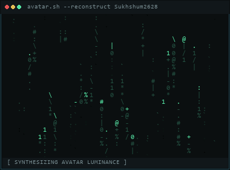
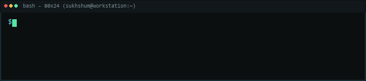

<div align="center">

# Sukhshum Vaishnavi

**Software Engineer**  
Distributed Systems • Multiplayer Networking • Backend Engineering • AI Platforms

<br/>

<table border="0">
  <tr>
    <td width="38%" align="center" valign="middle">
      <a href="https://github.com/Sukhshum2628"></a>
    </td>
    <td width="62%" align="center" valign="middle">
      <a href="https://github.com/Sukhshum2628"></a>
    </td>
  </tr>
</table>

<br/>

[](https://github.com/Sukhshum2628?tab=repositories)
[](https://www.linkedin.com/in/sukhshum-vaishnavi/)
[](https://sukhshum-portfolio.vercel.app/)
[](mailto:sukhsham2628@gmail.com)

<br/>

`[ STATUS: HOST AUTHORITY ACTIVE // DEVELOPING DISTRIBUTED SYSTEMS & STALKER-MP ]`

</div>

---

## $ neofetch --brief

```bash
sukhshum@workstation
--------------------
ROLE        : Software Engineer
SPECIALTIES : Distributed Systems, Multiplayer Networking, AI & ML, Systems Engineering
STACK_CORE  : C++17 / Python / TypeScript / Node.js / Docker
PRINCIPLES  : Host Authority • Deterministic Simulation • Preserve Before Replace
STATUS      : Developing STALKER-MP & exploring distributed architectures
```

---

## 🎮 Flagship: STALKER-MP

### [STALKER-MP // Persistent Multiplayer ALife Framework](https://github.com/Sukhshum2628/STALKER-MP)

> A modular, host-authoritative multiplayer framework layered on top of the X-Ray Monolith engine (S.T.A.L.K.E.R. Anomaly) that introduces a shared, persistent Zone without forking or rewriting the upstream engine.

```
[ Clients ] ──(Requests Only)──► [ Host-Authoritative Zone Engine ]
                                  ├── World & EntityRegistry (Deterministic)
                                  ├── A-Life Online/Offline Bubbles
                                  └── Snapshot & UDP Platform Transport
```

- **Host Authority:** Clients issue requests only; the host drives all world state, player lifecycle, and A-Life simulation transitions.
- **Deterministic Pipeline:** Strict per-frame execution ordering (`World` → `EntityRegistry` → `Lifecycle` → `Bubble` → `Snapshot` → `Networking`).
- **Engine ABI Boundaries:** Strict isolation with zero exceptions/RTTI across engine units (`EngineAdapters.cpp`) and OS sockets (`PlatformSockets.cpp`).

`Tech: C++17 • Visual Studio 2022 • GCC • GoogleTest • UDP • X-Ray Monolith`

---

## 💼 Featured Engineering Projects

### 🏗️ [ConstructIQ — AI Construction Intelligence](https://github.com/Sukhshum2628/ConstructIQ)

> AI-assisted construction planning and resource intelligence system bridging architectural CAD design with site execution.

- **CAD-to-Estimate QTO:** Automated `.DXF` geometric parsing (`ezdxf`) generating physical material takeoffs and CPWD labor-day estimates.
- **Weather & Geofence Gating:** GPS site validation and automated weather checks (Open-Meteo) preventing improper material placement.
- **Predictive Risk & RAG:** Z-Score material anomaly detection, XGBoost cost overrun classification, and localized project RAG via NVIDIA NIM.

`Tech: Python • FastAPI • Flutter • XGBoost • ChromaDB • NVIDIA NIM • Firebase`

### 🚨 [EduSafe — AI Disaster Preparedness Platform](https://github.com/Sukhshum2628/Edusafe-Platform)

> Institutional emergency drill and safety command system pairing real-time IoT overlays with mobile physics verification. [**Live Admin Demo**](https://edusafe-613b7.web.app)

- **Physics Drill Verification:** Evaluates device accelerometer G-forces and GPS displacement vectors to verify genuine safety actions.
- **AI Vision Gear Check:** Integrates Google Gemini 2.5 Flash for verified photographic inspection of safety equipment.
- **Real-Time Broadcast:** Synchronized Socket.IO engine delivering high-vibration alerts and dynamic safe muster point routing.

`Tech: Node.js • Express • React 19 • React Native • Socket.IO • Gemini 2.5 Flash • MongoDB`

### 📝 [Flask Blog — AI-Assisted Publishing Platform](https://github.com/Sukhshum2628/Flask-Blog-Website)

> Performance-optimized publishing engine featuring asynchronous AI workflows and smart caching.

- **Non-Blocking Inference:** Offloads LLM research and summarization to background threads (`ThreadPoolExecutor`) for high concurrency.
- **AI Research & Caching:** Web-grounded writing assistance (Tavily & Llama 3.1) with MongoDB-backed response caching to avoid redundant calls.

`Tech: Python 3.12 • Flask • MongoDB Atlas • Llama 3.1 (NVIDIA NIM) • Tavily API • Gunicorn`

---

## 🛠️ Technical Stack

- **Languages:** `C++17`, `Python`, `TypeScript`, `JavaScript`, `SQL`
- **Backend & APIs:** `Node.js`, `Express`, `FastAPI`, `Flask`, `Socket.IO`, `REST`
- **Databases & Vector:** `MongoDB`, `MySQL`, `ChromaDB`, `Firebase Firestore`
- **Cloud & DevOps:** `Docker`, `AWS`, `GitHub Actions`, `Linux / Bash`, `Vercel`
- **AI & Machine Learning:** `NVIDIA NIM`, `Gemini API`, `XGBoost`, `ezdxf CAD Engine`
- **Frontend & Mobile:** `React 19`, `React Native (Expo)`, `Flutter`, `Tailwind CSS`

---

## 📈 Activity Telemetry

<div align="center">

[](https://github.com/Sukhshum2628)

<br/>

[](https://github.com/Sukhshum2628)

</div>

---

<div align="center">

```bash
$ cat << 'EOF' > transmission.txt
Name     : Sukhshum Vaishnavi
Location : India (IST / UTC+5:30)
Email    : sukhsham2628@gmail.com
LinkedIn : https://www.linkedin.com/in/sukhshum-vaishnavi/
Portfolio: https://sukhshum-portfolio.vercel.app/
EOF
```

[](mailto:sukhsham2628@gmail.com)
[](https://www.linkedin.com/in/sukhshum-vaishnavi/)
[](https://sukhshum-portfolio.vercel.app/)

</div>
